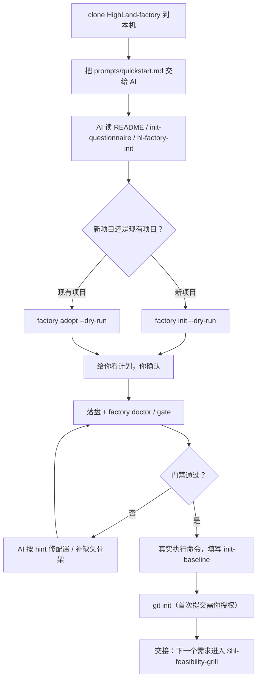
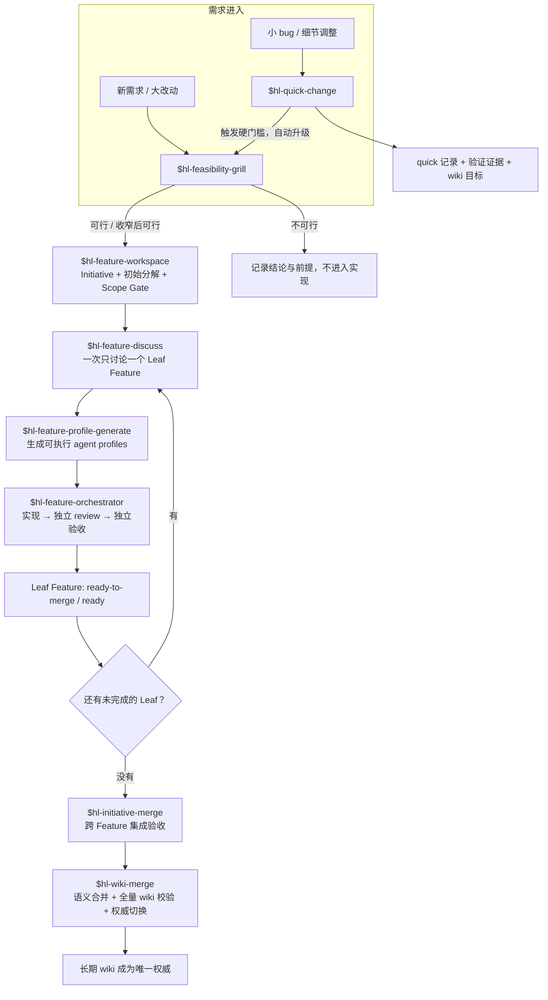
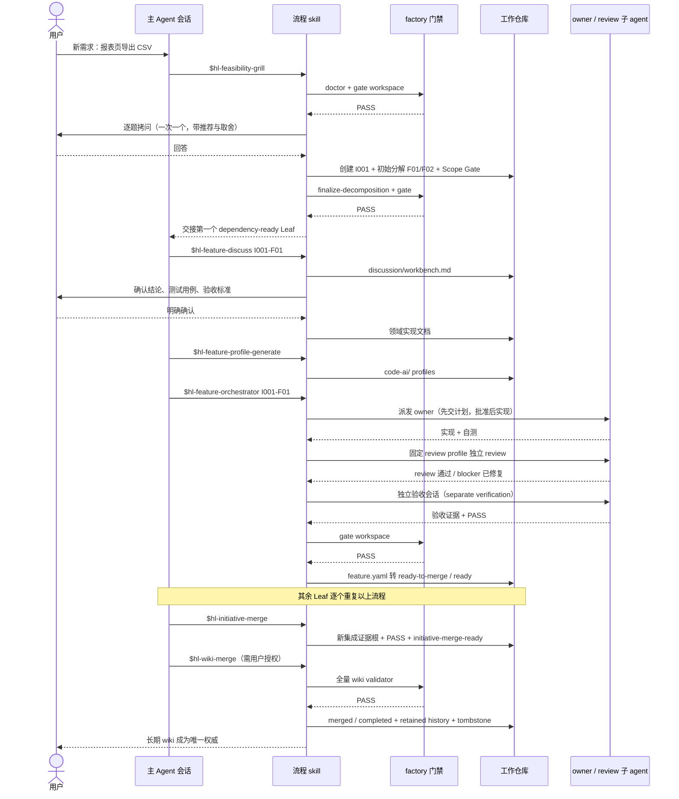
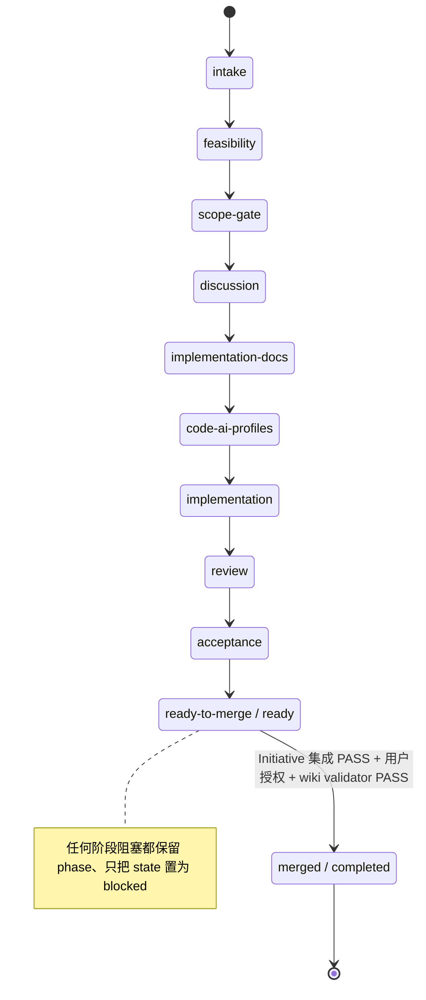
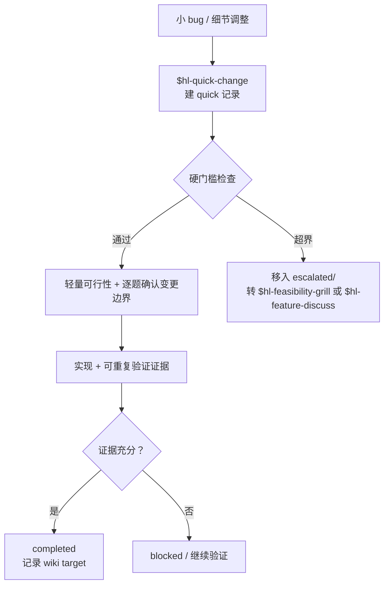

# HighLand-factory

一套**项目无关**的 AI 辅助研发流程：从需求可行性拷问、Feature 拆解、讨论、实现、独立评审、验收，到长期 Wiki 语义合并，全程有可执行门禁和可追溯状态。

它只做流程，不装项目事实。流程仓库和你的工作仓库分离：

```text
HighLand-factory/          # 本仓库，clone 一次，装到各个 agent
        │
        │  prompts/quickstart.md 引导 AI 初始化 / 接管
        ▼
<你的工作仓库>/            # 一个 git 仓库，两个文件夹
  code/                    # 代码
  wiki/                    # 长期权威文档 + feature-workspace + code-ai
  .factory/                # 项目配置（提交）+ 机器配置（忽略）
```

这就是核心设计：**一个工作仓库，`code/` 与 `wiki/` 两个文件夹；流程仓库不保存任何项目内容；初始化把项目事实写进工作仓库的配置和模板生成物。**

---

## 现在是什么状态

v0.1 已可用，核心链路已跑通：

- [x] 架构与契约：[docs/architecture.md](docs/architecture.md)、[docs/skill-contract.md](docs/skill-contract.md)
- [x] 初始化问卷与 DoD：[docs/init-questionnaire.md](docs/init-questionnaire.md)
- [x] engine：`init / adopt / doctor / upgrade / status / resolve / gate`
- [x] 工作仓库模板（wiki 权威 + code-ai + feature-workspace + quick-workspace）
- [x] 核心 skills（14 个，统一 `hl-` 前缀，避免与其他流程重名）+ 3 个可选 pack（`hl-commit` / `hl-dev-runtime` / `hl-remote-verify`）
- [x] AI 引导初始化 prompt：[prompts/quickstart.md](prompts/quickstart.md)
- [x] 安装脚本 + CI 守卫（模板冒烟、门禁测试、无项目泄漏）
- [x] 已用一套现有双仓项目的临时副本做 split 模式 adopt 验证（0 门禁错误）

尚未做：GitHub 仓库创建与 push（需要仓库所有者授权）。

---

## 快速开始：让 AI 带你初始化

**不需要背命令。** 你只需要 clone 本仓库，然后把 [prompts/quickstart.md](prompts/quickstart.md) 交给你的 AI agent；它会读工厂文档，**一次只问你一个决策**，一步步完成安装、初始化、门禁修复和 baseline。



### 你需要做的三步

1. **clone 本仓库**（只做一次）：

   ```bash
   git clone https://github.com/SearchLeeeee/HighLand-factory.git ~/HighLand-factory
   ```

2. **在你的 AI agent 里发起对话**，把 prompt 文件路径给它。例如：

   ```text
   读一下 <factory 路径>/prompts/quickstart.md，按里面的步骤带我初始化工作仓库。
   我是新项目，工作目录打算用 <你的工作目录>。
   ```

   现有项目就说清楚两个仓库：

   ```text
   读一下 <factory 路径>/prompts/quickstart.md，按里面的步骤带我初始化工作仓库。
   我是现有项目：文档/设计仓在 <docs 仓路径>，代码仓在 <code 仓路径>。
   ```

3. **回答它的问题、给它授权**。初始化由 AI 执行：它会先 `--dry-run` 给你看计划，再落盘；门禁失败会停下来修，不会偷偷绕过。

### AI 会做什么、不会做什么

| AI 会做 | AI 不会做（除非你明确授权） |
| --- | --- |
| 读工厂文档和初始化问卷，检测你的目录、git、技术栈 | 编造项目事实、架构或命令 |
| 一次一个问题地完成 P0 访谈 | 一次倾倒几十个问题 |
| 写 answers 文件，先 dry-run 再初始化 | 不看计划直接写文件 |
| 跑 `doctor` / `gate`，按 hint 修配置和缺失骨架 | 弱化门禁、手改生成文件、用 `--force` |
| 记录 baseline，准备 git 首次提交 | push 远端、重写已有权威文档、删除文件 |
| 输出可直接用于下一会话的交接提示词 | 在初始化阶段实现业务功能 |

### 手动模式（不用 AI 引导时）

前置：Git、Python ≥ 3.10（安装脚本会自举一个带 PyYAML 的 venv，或直接使用 `uv`）。

```bash
# 1. clone 流程仓库
git clone git@github.com:SearchLeeeee/HighLand-factory.git ~/HighLand-factory

# 2. 安装到本机（把 skills 链到 Codex / Claude / DSH 的技能目录，并生成 factory 命令）
cd ~/HighLand-factory
./install/install.sh          # Windows: .\install\install.ps1

# 3. 在目标目录初始化一个工作仓库
mkdir ~/my-project && cd ~/my-project
factory init --work .

# 4. 检查
factory doctor --work .
```

Windows 下路径示例：

```powershell
git clone https://github.com/SearchLeeeee/HighLand-factory.git <factory>
<factory>\install\install.ps1
mkdir <work>
cd <work>
<factory>\bin\factory.cmd init --work .
<factory>\bin\factory.cmd doctor --work .
```

如果你已经用别的工具管理 agent skills（例如 agent-config），用 `-NoSkills` / `--no-skills` 只装引擎，再把 `<factory>/skills` 注册为该工具的 external skill root；需要可选 pack 时加 `-WithPacks` / `--with-packs`。

手动初始化之前，用你惯用的 agent 打开工作仓库，输入 `$hl-factory-init`（对话式初始化）；已经手动 `factory init` 过的仓库直接从 `$hl-feasibility-grill` 或 `$hl-quick-change` 开始。也可以直接用 AI 引导 prompt 接管未完成的初始化。

---

## 四个核心概念

### 1. 流程仓库（本仓库）

只包含引擎、skills、模板、安装脚本和文档。升级方式是 `git pull` + `factory upgrade`。**不要**把项目文档、项目配置、密钥或领域知识提交到这里；CI 会检查项目泄漏。

### 2. 工作仓库

一个普通 git 仓库，顶层固定两个文件夹：

| 目录 | 内容 |
| --- | --- |
| `code/` | 实现代码。`mono` 模式下与 wiki 同仓；`split` 模式下指向外部代码仓 |
| `wiki/` | 长期权威文档、`feature-workspace/`、`quick-workspace/`、`code-ai/` agent profiles |

`.factory/factory.yaml` 是唯一项目配置真源；`.factory/local.yaml` 存本机路径和运行时，不提交。

### 3. 工作流摘要

`wiki/governance/workflow-profile.md` 由引擎从 `factory.yaml` 生成：语言、布局、owner、真实命令、门禁开关、安全边界。**所有 skill 第一步先读它**，所以 skill 里不需要出现任何项目名、绝对路径或机器 token。

### 4. 可执行门禁

流程不靠散文约束：

- `feature_workspace.py`：唯一生命周期状态机（Feature/Initiative 状态、依赖、Scope Gate、合并门禁、集成证据）
- `validate_llm_wiki.py`：长期 Wiki 唯一内容门禁（唯一入口、≤3 跳可达、链接完整、工作区隔离）
- `trace_feature_history.py`：唯一历史溯源读取器
- 其余 skill 通过 `factory gate ...` 调用它们，散文只解释"何时调用"，不重新定义规则

---

## 全流程使用示例

下面用一个示例走完整条链路。假设工作仓库 `~/demo` 已经初始化完成，现在要加一个需求：**「报表页支持把当前视图导出为 CSV」**。

### 1. 一图总览：两条通道



要点：

- **需求只有两个入口**：大需求走可行性拷问，边界明确的小改动走 Quick Change。Quick Change 超界时必须升级，不能硬撑。
- **一个 Leaf Feature 走完讨论 → profiles → 实现 → review → 验收 → ready**，才会进入 Initiative 合并屏障。
- **Feature 就绪 ≠ Initiative 可合并 ≠ 长期 wiki 权威切换**，这是三个不同的门。
- `$hl-feature-progress` 是只读旁路，任何时刻都能问进度和下一步，不会改状态。

### 2. 一个完整 Feature 的走法



#### 第 1 步：可行性拷问（`$hl-feasibility-grill`）

新会话里直接说需求，AI 会用强审视角追问：真实问题、边界、数据/权限来源、最难依赖、降级方案、不可接受的影响。每个问题都带推荐方向。

结束时你会拿到一个 verdict（`Feasible` / `Conditionally feasible` / `Risky` / `Not feasible`）和交接提示词。可行时，这个 skill 会：

1. 创建 Initiative（示例：`I001`，`wiki/feature-workspace/initiatives/initiative-i001-csv-export/`）；
2. 建立**完整初始 Feature inventory**（示例：`I001-F01` 同步导出当前视图，`I001-F02` 异步导出大结果集，`depends_on: [I001-F01]`）；
3. 对每个候选跑 Scope Gate，`must-split` 立即拆分；
4. 跑 `finalize-decomposition` 封存 inventory，再运行 `factory gate workspace`。

> 不允许创建一个宽泛的 F01 承载整个 Initiative 的讨论。可行性结论会作为 prior constraints 记录下来，后续讨论不得无新证据地重开。

#### 第 2 步：逐个 Leaf 讨论（`$hl-feature-discuss`）

```text
$hl-feature-discuss I001-F01
```

这个 skill 一次只处理**一个** dependency-ready 的 Leaf Feature：

- 先问你要哪个讨论模式：**交互式**（一次一个问题）或**批量审阅**（把问题写进 workbench，你批量回答）；
- 只写 `discussion/workbench.md`：问题清单、已确认结论、未决问题、领域划分、文档目标、profile 目标；
- 你明确确认讨论完成后，才创建领域实现文档（含测试用例与验收标准）；
- 最后交接给 profiles 阶段。

示例产物：

```text
wiki/feature-workspace/initiatives/initiative-i001-csv-export/
  initiative.yaml
  features/feat-i001-f01-sync-export/
    feature.yaml
    discussion/workbench.md
    backend/export.md
    testing/export-acceptance.md
```

#### 第 3 步：生成可执行 profiles（`$hl-feature-profile-generate`）

```text
$hl-feature-profile-generate
```

它把讨论结论和领域文档组合成可直接投喂 subagent 的 profiles（**引用** `wiki/code-ai/` 的通用约束，不复制）：

```text
feat-i001-f01-sync-export/
  code-ai/
    README.md
    backend-implementation-agent-profile.md
    review-agent-profile.md
    verification-agent-profile.md
```

生成前会检查 `feature.yaml` 的五维 `consistency_matrix` 完整、`gate workspace` 通过。

#### 第 4 步：实现 → 独立 review → 独立验收（`$hl-feature-orchestrator`）

```text
$hl-feature-orchestrator I001-F01
```

主会话负责协调和门禁，不自己写业务代码：

1. 预检：phase 必须是 `code-ai-profiles / completed`，Scope Gate 通过，依赖满足，owner 写作用域不重叠；
2. 派发 owner 子 agent（只给允许/禁止文件、验收标准、验证命令），**先交计划，批准后才改文件**；
3. 实现完成后跑**固定 review profile** 做独立 review，blocker 必须修复并重审；
4. `workflow.verification_separate` 开启时，验收在独立会话中执行，用真实命令和证据；
5. 状态机推进：`implementation → review → acceptance → ready-to-merge / ready`，每次推进后都跑 `factory gate workspace`。

Feature 不会停在 `implementation / completed` 或 `review / completed`：最后一步必须是 `ready-to-merge / ready`，否则不算完成。

#### 第 5 步：其余 Leaf 与 Initiative 集成（`$hl-initiative-merge`）

`I001-F02` 走同样的讨论 → profiles → 实现流程。当所有未取消、未替代的 Leaf 都是 `ready-to-merge / ready` 后：

```text
$hl-initiative-merge I001
```

它会冻结本轮 revision，生成一次性的集成测试交接，在**新的不可变证据根**里跑跨 Feature 链路、共享契约、负向路径和安全边界，然后：

```bash
feature_workspace.py initiative-integration-result --registry ... --initiative I001 --evidence <证据文件>
feature_workspace.py initiative-merge-ready    --registry ... --initiative I001
```

集成 PASS 前，任何 Feature 都不允许先合并。

#### 第 6 步：语义合并与权威切换（`$hl-wiki-merge`）

拿到用户的合并授权后，按 `depends_on` 拓扑顺序逐个合并：

```text
$hl-wiki-merge <feature-root>
```

合并是**语义合并**，不是把 Feature 文档追加进 wiki：

1. 只把长期需要的需求、契约、测试预期、运维事实折叠进现有权威文档和对应 MOC；
2. 更新所有受影响的 MOC；
3. 跑**全量**长期 wiki validator（排除 feature/quick workspace）；
4. validator PASS 后，才做 retained-history 转换（`RETAINED_HISTORY.md`、`history-route.yaml`、checksum）、写 tombstone、把 Feature 置为 `merged / completed`、切换权威；
5. 原始 Feature 目录**保留不删**，降级为非权威历史，只能通过 `$hl-history-trace` 定向追溯。

完成后，长期 wiki 是业务、契约、实现、测试和运维的唯一权威。以后再改这个能力，要新建 Initiative 并**从长期 wiki 读基线**，不能继续改已合并的历史材料。

#### 每一步的产物与门禁

| 阶段 | 触发 | 主要产物 | 机器门禁 |
| --- | --- | --- | --- |
| 初始化 | `prompts/quickstart.md`（或 `$hl-factory-init`） | 工作仓库骨架、`factory.yaml`、baseline | `doctor --strict`、`gate all` |
| 可行性 | `$hl-feasibility-grill` | verdict、Initiative、初始分解、Scope Gate | `gate workspace` |
| 讨论 | `$hl-feature-discuss` | workbench、领域实现文档 | `gate workspace` |
| Profiles | `$hl-feature-profile-generate` | feature `code-ai/` | `gate workspace` |
| 实现/评审/验收 | `$hl-feature-orchestrator` | 代码、review 记录、验收证据 | 配置的真实命令、review 门禁 |
| Leaf 就绪 | orchestrator | `ready-to-merge / ready` | `merge-ready --feature` |
| Initiative 集成 | `$hl-initiative-merge` | 集成证据、PASS | `initiative-merge-ready` |
| 长期合并 | `$hl-wiki-merge` | 权威 wiki 更新、retained history、tombstone | 全量 `validate_llm_wiki` |
| 进度查询 | `$hl-feature-progress` | 只读报告、下一会话提示词 | `gate workspace`（只读） |
| 小改动 | `$hl-quick-change` | quick 记录、验证证据、wiki 目标 | 硬门槛自检 |

### 3. Feature 生命周期状态机



- `phase` 表示流程走到哪，`state` 表示当前运行状态（`not-started` / `in-progress` / `blocked` / `ready` / `completed` / `cancelled` / `superseded`）。
- 阻塞时**保留原 phase**，只把 `state` 改成 `blocked` 并写 blocker；取消或替代保留编号、不回收 ID。
- 状态只在 skill 边界变化，且必须通过 `feature_workspace.py`，不能手改 YAML。

### 4. 小改动：Quick Change



示例：修复日期筛选 off-by-one。

```text
$hl-quick-change 修复报表日期筛选在月末差一天的问题
```

- 记录写到 `wiki/quick-workspace/active/quick-20261023-001.md`，完成后移入 `completed/`；
- 只要触发数据迁移、公共契约/权限/安全边界、多业务目标、无法本地重复验证等硬门槛，就**立即升级**，把记录移入 `escalated/` 并转重流程；
- quick 记录只是过程材料，不是生命周期权威；需要改长期 wiki 时仍然走 `$hl-wiki-merge`。

### 5. 随时查进度

```text
$hl-feature-progress
```

严格只读：报告每个 Feature 的当前 skill/phase/state、剩余阶段、阻塞、可并行的 dependency-ready 工作、下一步该由哪个 skill 维护哪个 manifest，并能生成可复制的下一会话提示词。它不会替你推进状态。

---

## 项目落地：从零项目 vs 现存项目

`init` 与 `adopt` 共用同一个生成器，区别只在**前置条件**和**对已有文件的处理**。

### 从零项目

```bash
factory init --work <新目录> [--answers answers.yaml]
```

- 目录不存在会自动创建；默认 `mono` 模式（`code/` + `wiki/` 同仓）。
- 生成完整骨架（约 57 个文件）：入口 `README.md` / `AGENTS.md` / `CLAUDE.md`、`code/` 种子、wiki 权威骨架、`workflow-profile.md`、`feature-workspace/`、`quick-workspace/`、`code-ai/` profiles、baseline。
- 不生成业务代码；命令为空、baseline 为 pending、未 `git init` 时 `factory doctor` 会给出 warning。
- 目录**不要求为空**：已存在文件同样跳过，只补缺失骨架；混入已有内容时先跑 `--dry-run` 看计划。

### 现存项目（adopt）

```bash
factory adopt --work <docs仓> --code <code仓> [--wiki <wiki目录>] [--answers answers.yaml]
```

- `<work>` 与 `--code` 必须已存在；代码在 work 内 → `mono`，在 work 外 → `split`；wiki 自动探测 `wiki/`、`docs/`，其他目录名必须用 `--wiki` 显式指定。
- **已有文件一律不覆盖**：只补缺失的通用骨架；现有权威文档只追加 MOC 链接和 `.gitignore` 条目，不改写正文；代码仓只读引用，不复制、不移动、不改历史。
- 不迁移旧 Feature ID、旧 wiki 目录结构、旧 skills（v0.1 不做自动迁移）；旧 registry 若不兼容，`factory doctor` 会报错，需要人工处理。
- `--dry-run` 完全只读；不运行 adopt 就不会碰任何现有仓库。
- 已初始化的仓库（已有 `.factory/factory.yaml`）会被拒绝，应改用 `factory doctor` / `$hl-factory-doctor`。

### 建议

- 任何 `init` / `adopt` 都先跑 `--dry-run --json` 看计划，再决定是否落盘。
- 现存项目先打标签（如 `git tag pre-adopt-<date>`），把“机械生成”和“人工修链接/配置”分成两次提交。
- 不要用 `--force` 覆盖已有文件；`--force` 只用于明确的重建。
- 如果只是把 HighLand-factory 当流程参考，**不需要对任何现有仓库运行 init/adopt**：新建一个空目录跑 `factory init` 即可得到一套完整示例工作仓库。
- 初始化后先跑 `factory doctor --strict`，再把 `factory.yaml` 里的 build/test/verify 实跑一遍并更新 baseline。

完整问卷与验收标准见 [初始化问卷与 DoD](docs/init-questionnaire.md)。

---

## 升级

工厂仓库更新后，用升级脚本把新版本同步到本机 agent：

```bash
cd <factory>
git pull --ff-only
./install/upgrade.sh        # Windows: .\install\upgrade.ps1
```

它会做三件事：

1. 重建/校验 `<factory>/.venv` 与 `bin/factory`；
2. 把 `skills/` 和 `packs/` 重新链接到各 agent 的技能根目录：新增的补上、已删除的清理掉，非 factory 管理的链接不动；
3. 可选刷新已初始化的 work repo：`-Work <path>` 更新其 `local.yaml`，加 `-ApplyWorkUpgrade` 还会应用生成物升级并跑 doctor。

常用参数：

| 参数 | 作用 |
| --- | --- |
| `-Pull` / `--pull` | 先执行 `git pull --ff-only` 再同步 |
| `-Work <path>` / `--work <path>` | 刷新指定 work repo（可多个） |
| `-ApplyWorkUpgrade` / `--apply-work-upgrade` | 对 work repo 执行 `factory upgrade --apply` + doctor |
| `-NoSkills` / `--no-skills` | 只更新引擎，不动 agent 技能根（适合 agent-config 等外部管理器） |
| `-SkillsRoot <path>` / `--skills-root <path>` | 链接到自定义技能根，而不是自动探测的 agent 目录 |
| `-WithPacks` / `--with-packs` | 同时链接可选 packs |

同步后重启 agent 会话，让技能列表重新加载。

### 交给 agent-config 管理时怎么更新

如果 agent 技能根由 [agent-config](https://github.com/SearchLeeeee/agent-config) 统一管理，不要让本仓库的 `install/upgrade` 直接写 agent 目录；把 factory 作为 **external skill root** 注册一次，之后更新只有两步。

**首次注册**（在 agent-config 仓库里，路径按本机实际值）：

```yaml
# sources.yaml
external_skill_roots:
  - id: highland-factory-skills
    root: ${FACTORY_ROOT}
    skills_subdir: skills
  - id: highland-factory-packs
    root: ${FACTORY_ROOT}
    skills_subdir: packs
```

```yaml
# local/machine.yaml（不进 git）
vars:
  FACTORY_ROOT: <factory-checkout-path>
```

然后运行 `tools/sync.ps1`，agent-config 会把 `skills/hl-*` 和 `packs/hl-*` 以 junction 方式挂到各 agent 技能根。

**日常更新**：

```bash
git -C <factory> pull --ff-only
<factory>/install/upgrade.ps1 -NoSkills     # 更新引擎/venv，不动 agent 目录
<agent-config>/tools/sync.ps1               # 新增/删除/改名的 skill 需要这一步
<agent-config>/tools/doctor.ps1             # 验证 agent 是否能看到
```

说明：

- external root 是原地 junction，**skill 内容更新会立即生效**；只有新增/删除/重命名 skill 时才必须重跑 `sync.ps1`。
- `-NoSkills` 只更新 `<factory>/.venv` 和 `bin/factory`；work repo 的生成物升级仍用 `-Work <path> -ApplyWorkUpgrade`。
- factory skills 不含 `${TOKEN}`，符合 agent-config external root "不渲染、原地读取"的约束。
- 所有技能都带 `hl-` 前缀，与 agent-config 里原有技能不冲突；旧的项目专属技能可以保留给现有项目，也可以之后在 agent-config 里逐步退役。

## 仓库结构

```text
HighLand-factory/
  engine/            # 确定性 CLI（本仓库的"机器门禁入口"）
  skills/            # 流程技能，统一 hl- 前缀，无项目事实
  templates/         # 工作仓库骨架（wiki / code-ai / .factory / code）
  prompts/           # 交给 AI 的启动 prompt（quickstart.md）
  install/           # 安装/升级脚本、生成 factory 命令
  packs/             # 可选能力（hl-commit / hl-dev-runtime / hl-remote-verify）
  docs/              # 架构、技能契约、初始化问卷、定制、升级、FAQ
  examples/          # 最小示例、adopt 现有项目的配置示例
```

## 文档

- [AI 引导初始化 prompt](prompts/quickstart.md)
- [架构与设计决策](docs/architecture.md)
- [技能契约（每个 skill 必须遵守）](docs/skill-contract.md)
- [技能与 pack 目录](docs/skill-catalog.md)
- [初始化问卷与 DoD](docs/init-questionnaire.md)
- [定制与维护](docs/customization.md)
- [升级与漂移处理](docs/upgrade.md)
- [FAQ](docs/faq.md)
- [Adopt 现有双仓项目示例](examples/adopt-existing-project/README.md)

## 与旧流程的关系

HighLand-factory 把一套已跑通的私有流程抽象成通用实现，但不是任何具体项目的复制品：去掉了双仓绑定、机器 token 渲染、领域事实和厂商依赖，改成固定布局 + 项目配置 + 可执行门禁 + 初始化/升级闭环。技能命名与职责见 [docs/skill-contract.md](docs/skill-contract.md#5-skill-naming)。

## License

[MIT](LICENSE)
